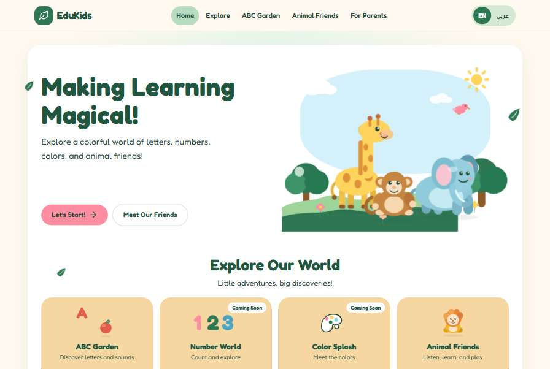

# 🌿 EduKids — Explore, Learn & Play!

<p align="center">
  
</p>

<h3 align="center">
  A playful bilingual learning experience for little explorers.
</h3>

<p align="center">
  🌈 Learn Through Play &nbsp; • &nbsp;
  🌍 English & Arabic &nbsp; • &nbsp;
  🐘 Explore the World
</p>

---

## 📖 About EduKids

**EduKids** is a playful, interactive educational website designed for toddlers aged **2–4 years**.

Inspired by nature and friendly animal characters, EduKids creates a welcoming environment where little learners can explore letters, numbers, colors, and animals through engaging activities.

The website supports both **English and Arabic**, including right-to-left layouts for Arabic, making the experience accessible to children exploring either language.

EduKids combines a colorful, child-friendly interface with interactive learning activities, responsive design, and browser-based speech features.

---

## ✨ Features

### 🔤 ABC Garden
Explore letters and discover new words!

- English alphabet from A to Z.
- Arabic alphabet exploration.
- Interactive letter navigation.
- Associated words and illustrations.
- Browser-based pronunciation where supported.

### 🔢 Number World
Discover numbers and practice counting!

- Numbers from 1 to 10.
- English and Arabic number names.
- Visual counting activities.
- Interactive objects for counting practice.

### 🎨 Color Splash
Explore a colorful world!

- Six colors to discover.
- English and Arabic color names.
- Colorful illustrations.
- Interactive color selection.

### 🐾 Animal Friends
Meet friendly animal characters!

- Explore eight animals.
- Discover animal names in both languages.
- Interactive animal cards.
- Accessible animal detail dialogs.

### 🎮 Mini Games
Learn through simple interactive games!

- **Find the Animal** — explore and identify animals.
- **Match the Color** — practice recognizing colors.
- **Count with Me** — practice counting objects.

Each game provides feedback and lets children continue at their own pace.

### 🌍 Bilingual Interface
Switch between English and Arabic.

- English left-to-right layout.
- Arabic right-to-left layout.
- Translated learning content and interface elements.

### 📱 Responsive Design
A responsive interface designed for desktop computers, tablets, and mobile devices.

### 💾 Local Progress Tracking
EduKids stores learning activity progress in the browser using `localStorage`.

No account is required, and progress is stored locally on the device.

### 🔊 Browser-Based Speech
Uses the Web Speech API to pronounce supported text when available.

Speech support and voice availability depend on the browser and device.

---

## 🛠️ Tech Stack

| Technology | Purpose |
|---|---|
| React | Building interactive user interfaces |
| Vite | Development server and production builds |
| JavaScript | Application logic |
| CSS | Styling, animations, and responsive layouts |
| Framer Motion | UI animations |
| Lucide React | Interface icons |
| Web Speech API | Browser-based speech synthesis |
| localStorage | Local progress persistence |

---

## 🚀 Getting Started

Follow these instructions to run EduKids locally.

### Prerequisites

Make sure you have installed:

- [Node.js](https://nodejs.org/)
- npm
- [Git](https://git-scm.com/)

### 1. Clone the Repository

```bash
git clone https://github.com/sama-eldakkash/EDUkids.git
```

### 2. Navigate to the Project

```bash
cd EDUkids
```

### 3. Install Dependencies

```bash
npm install
```

### 4. Start the Development Server

```bash
npm run dev
```

Open the local URL displayed in your terminal.

### 5. Build for Production

```bash
npm run build
```

### 6. Preview the Production Build

```bash
npm run preview
```

---

## 📂 Project Structure

```text
EDUkids/
├── public/
├── src/
├── index.html
├── package.json
├── package-lock.json
├── vite.config.js
├── vercel.json
└── README.md
```

The structure above is a simplified overview. Explore the repository for the complete source code and assets.

---

## 🎯 Project Goals

- Create a playful and welcoming digital learning experience.
- Encourage exploration through interactive educational activities.
- Support early exposure to English and Arabic.
- Build responsive and reusable React components.
- Explore browser speech capabilities and local progress tracking.
- Apply modern frontend development practices.

---

## 🔮 Future Improvements

Potential future enhancements include:

- Additional educational games.
- More interactive learning activities.
- Expanded accessibility testing.
- Enhanced audio experiences.
- Optional parent-facing progress insights.
- Backend integration if future requirements call for it.

---

## 👩‍💻 Developer

**Sama Eldakkash**

Computer Science — Software Development

[GitHub Profile](https://github.com/sama-eldakkash)

---

<p align="center">
  🌱 Made with creativity and care for little learners.
</p>
